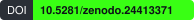

# Six record surfaces packed with conics, written down exactly

**Degtyarev proved these record surfaces exist from lattice data alone, without equations; we wrote down equations for six of them and proved their exact conic counts, among them a surface whose 656 conics are all real, the most known on any real quartic.**

[](https://doi.org/10.5281/zenodo.24413371)  [](https://github.com/Hashirama1337s)

Moki & Julio · 2026 · version 1.0

**Read** [PAPER.md](PAPER.md) · **Re-run** [code/README.md](code/README.md) · **Check** [CORRECTIONS.md](CORRECTIONS.md) and the sealed files in [bars/](bars/)

## In plain words

A quartic surface is the set of points in space that satisfy one polynomial equation of degree 4. Some smooth quartic surfaces contain conics: ellipses, parabolas and hyperbolas lying entirely inside the surface. In 2024 Alex Degtyarev proved that a smooth quartic holds at most 800 conics. He also listed many surfaces that come close, but only as lattice data: a table of how their conics meet one another, with no equation.

One of those surfaces, with 656 conics, is the real record: all 656 conics are real curves that you could draw, the most known on any real quartic. Degtyarev's theorem leaves the true real maximum somewhere between 656 and 718. For most of his surfaces no equation was known (none found at our search floor, 20-21 November 2026). In 1994 Barth and Bauer had proved that quartics with 16 disjoint conics exist, and wrote that they did not find their equations.

We turned six of these lattice patterns into equations (for the 736 and 640 surfaces the parameter value was already in print as a special point of the Dwork family; what is new there is the identification with the surface, its conics and the certificates), for surfaces with 656, 664, 704, 736, 660 and 640 conics. For each one we wrote down every conic exactly, checked every conic identity in two independent computer algebra systems, and proved that no further conic hides anywhere. Two of the six, with 704 and 640 conics, are Barth-Bauer quartics.

**A picture.** Degtyarev's tables are like a floor plan that proves a building exists and says what rooms it has, but gives no street address. We found an address (an equation) for six of the buildings, walked in, and counted every room. **Where the picture breaks.** A surface has no single address: any change of coordinates gives another equation for the same surface. And for the 664 surface, the match between our equation and Degtyarev's floor plan is by summary numbers, not room by room.

## Start here

1. **Two minutes.** Read "What we found" below: each result with the way it was checked.
2. **Twenty minutes.** Read [PAPER.md](PAPER.md). Every section opens with a paragraph in plain words.
3. **Deep.** Re-check a surface yourself with [code/README.md](code/README.md), which has one command per step. Every number in the paper is in a shipped transcript next to the script that made it.

## What we found

| result | how it was checked | status |
|---|---|---|
| **656.** A real quartic with exactly 656 conics, all real, all with real points, and no lines | every conic written exactly over one number field of degree 12; identities checked in PARI/GP and Singular; reality and the full table of conic intersections decided by ball arithmetic; the count then proved exact by a lattice argument; sealed count 656 at two primes and in a second chart | `EXACT` · `CERTIFIED` · sealed Q1, Q2 `HOLD` within BAR-656-POINT, which is `FAILED` overall (control Q3) |
| **664.** A quartic with exactly 664 conics, over $`\mathbb{Q}(\sqrt{-5})`$ | same chain, exact intersection table; sealed count at three fresh primes with two independent counters | `EXACT` · sealed `HOLD` 5/5 |
| **704.** The Barth-Bauer 704 quartic, with exactly 704 conics | same chain; explicit conic-for-conic match with Degtyarev's 704 lattice | `EXACT` · sealed `HOLD` 3/3 |
| **736.** A quartic with rational coefficients and exactly 736 conics | same chain; explicit match with Degtyarev's lattice; its Dwork parameter value was already in print | `EXACT` · sealed `HOLD` 3/3 |
| **660 and 640.** Exactly 660 and exactly 640 conics, both with rational coefficients; 640 is the Barth-Bauer 640 quartic | same chain; explicit matches with Degtyarev's lattices | `EXACT` · sealed `HOLD` 5/5 |
| **A conic map of Goursat's family**, the two-dial family of 1887 that holds the 656 record: eight special curves carry extra conics, and the counts add up by a simple rule (each branch of a curve through the point counts) at all 23 points tested, 22 of them predicted before the run; the branch detail was found after a failed sealed control (POST HOC) | conic counter modulo primes, two charts; that no ninth curve exists is a written argument | `MODULAR` · `ARGUED` |
| **Two corrections to the literature**: an inverted Dwork parameter value and a likely sign slip | first: our counts, the authors' own formula and figure, and a later paper that prints the value correctly (strong); second: one development point in two charts (moderate) | `ARGUED` |
| **Six certified generic counts of Pichon-Pharabod and Telen reproduced** by our counter | counts modulo primes, with multiplicity | `MODULAR` |
| **One step in Lean.** The index-2 exclusion in the 656 lattice argument | 10 theorems accepted by Lean's kernel; a control file that claims the opposite fails | `EXACT` (kernel-checked) |

One sealed test, BAR-656-POINT, is `FAILED` overall: its target predictions held, but a control point predicted at 512 conics gave 560. The scorecard below keeps it.

## The gallery

Notation: $`q = x^2+y^2+z^2`$, $`p_4 = x^4+y^4+z^4`$; in four variables, $`\Sigma x^4 = x^4+y^4+z^4+w^4`$ and $`\Sigma x_i^2x_j^2`$ is the sum of the six products of distinct squares.

| conics | equation | field of the equation | symmetries | real picture | status |
|---|---|---|---|---|---|
| **656** | $`E w^4 - E q w^2 + q^2 + t p_4 = 0`$, with $`9t^3+48t^2+125t+122 = 0`$ (real root $`t \approx -1.80081`$) and $`E = (1688-1140t-1044t^2)/361 \approx 0.98429`$ | cubic field of discriminant $`-244`$ ($`x^3+x-6`$); all conics over one field of degree 12 | 48 ($`C_2 \times S_4`$) | **all 656 conics real, all with real points** (the real record) | `EXACT` · `CERTIFIED` (reality and the intersection table) |
| **664** | $`\Sigma x^4 - \Sigma x_i^2x_j^2 + 3\sqrt{-5}\, xyzw = 0`$ | $`\mathbb{Q}(\sqrt{-5})`$; conics over $`\mathbb{Q}(i,\sqrt3,\sqrt5)`$ | 96 | two real forms: 32 real conics (12 with real points); 36 real (all with real points) | `EXACT` |
| **704** | $`\Sigma x^4 + \lambda(\Sigma x^2)^2 = 0`$, with $`52\lambda^2+36\lambda+9 = 0`$, $`\lambda = (-9 \pm 6i)/26`$ | $`\mathbb{Q}(i)`$; conics over a degree-8 field $`\mathbb{Q}(i,\sqrt{\varepsilon})`$, $`\varepsilon = (3+\sqrt{13})/2`$ | 192 ($`W(B_4)/\pm1`$) | a complex-conjugate pair; whether it has a real model is untested | `EXACT` · the Barth-Bauer 704 quartic (explicit lattice match) |
| **736** | $`-x^4+y^4+z^4+9w^4+6xyzw = 0`$ | $`\mathbb{Q}`$; conics over $`\mathbb{Q}(\zeta_{24})`$ | 384 | rational form: 20 real conics (10 with real points); other real form: 40 real (all with real points) | `EXACT` |
| **660** | $`6(x_1^4+\dots+x_5^4) + (x_1^2+\dots+x_5^2)^2 = 0`$ on $`x_1+\dots+x_5 = 0`$ | $`\mathbb{Q}`$; conics over $`\mathbb{Q}(i,\sqrt3,\sqrt5)`$ | 120 ($`S_5`$) | three real forms: 0, 0 and 32 real conics (0, 0 and 28 with real points); the given rational form has no real points at all | `EXACT` |
| **640** | $`\Sigma x^4 - \Sigma x_i^2x_j^2 + 10\,xyzw = 0`$ | $`\mathbb{Q}`$; conics over $`\mathbb{Q}(\zeta_{24})`$ | 384 | rational form: 32 real conics (16 with real points); best real form: 48 real (44 with real points) | `EXACT` · the Barth-Bauer 640 quartic (explicit lattice match) |

The 656 surface written with real coefficients in the form used by the counting runs is $`w^4 - e\,q\,w^2 + q^2 + t\,p_4 = 0`$ with $`e = +\sqrt E \approx 0.99211`$; it is the same real surface after the real rescaling $`w \mapsto E^{1/4} w`$. The 640 surface is the Hadamard image of the Dwork member $`\Sigma x^4 + 28\,xyzw = 0`$.

How the 656 surface was found: in Goursat's family, eight curves in the dial plane carry extra conics. The record sits at the one point where three of them meet, inside the only region of the real plane where all 392 generic conics are real (found by sampling, `NUMERICAL`) ([PAPER.md](PAPER.md), sections 3 and 7).

## Scorecard: the sealed tests

Every count below was predicted in a sealed file (written and hashed before the run, in [bars/](bars/)) and scored without moving the goalposts. `HOLD`: all predictions passed. `FAILED`: at least one prediction failed (kept and reported, never re-scored).

| sealed test | seal id | verdict | what it tested |
|---|---|---|---|
| BAR-656-COUNT (+ amendment) | d9712307b9 (amendment ba6da1440e) | `HOLD` 5/5 | the conic counter, calibrated before it touched any target: random quartic 0, Mukai quartic 800, two generic family members 392 each, 56 conics through the special point, two charts and a second engine agree |
| BAR-656-POINT | 5ab888ffae | `FAILED` (Q1, Q2 `HOLD`; Q3 `FAILED`) | the target point carries 656 conics at two primes and in a second chart (held). The control, a rational point on two of the three curves, was predicted at 512 and gave **560**. Reason, found afterwards and labelled POST HOC: that point is a node of one curve, so two branches of it each add 48 conics. The target prediction held; the bookkeeping rule behind the control did not |
| BAR-664-POINT | e891e02e23 | `HOLD` 5/5 | 664 at three fresh primes with two independent counters; controls 464 (generic) and 472 (special line) |
| BAR-704-POINT | 987d51a5a6 | `HOLD` 3/3 | 704 at two fresh primes with two counters; control 512 |
| BAR-736-POINT | e04e3c3432 | `HOLD` 3/3 | 736 at two fresh primes with the independent counter; control 608 |
| BAR-660-640 | 4baad3e0e3 | `HOLD` 5/5 | 660 and 640 at fresh primes with the independent counter; control 560 |

Sealed counts are counts modulo primes (`MODULAR`). The exact counts over the complex numbers come afterwards, from the certification chain in PAPER.md sections 3 to 6a.

Status words: `EXACT` exact arithmetic (our scripts or a named program) · `CERTIFIED` rigorous interval (ball) arithmetic: every sign or integer it reports is proved, not estimated · `MODULAR` exact arithmetic modulo primes · `NUMERICAL` floating point, used only to guide a search or as support · `CITED` published by others, named · `ARGUED` written argument, not machine-checked · `UNTESTED` a lead we noticed and did not test.

## What we did not find, and do not claim

- **Not the existence of these surfaces.** Their existence, their lattices, their conic configurations and symmetry groups as abstract data, the 800 bound and the real bounds 656 to 718 are Degtyarev's.
- **Not the true real maximum.** Nothing here decides whether some other real quartic has more than 656 real conics; Degtyarev's bound leaves room up to 718. Within Goursat's family, 656 is the real maximum by a written argument with one numerical step (`ARGUED`).
- **Not the Dwork parameter values.** The values of the 736 and 640 surfaces were printed before as special (CM) points. What we claim for them is the identification with the surfaces, their conics and the certificates.
- **Not the only 656-conic surface.** Veniani's Q56 also has 656 conics and a published equation; its transcendental lattice has determinant 60, not 244, so it is a different surface from the all-real one.
- **No conic-for-conic match for 664.** Its match with the Barth-Bauer 664 row is by lattice invariants only.
- **Real structures only from projective maps.** Other real structures, the topology of the real surfaces, and the real model of the 704 surface were not studied.
- **Sealed counts are modular.** The exact counts rest on the certification chain, which uses standard K3 facts that we did not reopen.
- The two corrections to the literature are `ARGUED`, one strong, one moderate ([CORRECTIONS.md](CORRECTIONS.md), Part 2).

## Open doors

What this work leaves open, for anyone who wants to take the next step.

- **Is 656 the real record, or can a real quartic hold up to 718 real conics?** *Status:* `UNTESTED` here; open between Degtyarev's bounds. *Start here:* [PAPER.md](PAPER.md), sections 7 and 9.
- **The next real candidate, 616 conics, needs a bigger toolbox.** That pattern has too few symmetries: its family has four dials, and four special conditions would have to meet at one point. We stopped there. *Start here:* PAPER.md, section 10.
- **A quaternion structure behind Goursat's family.** The family's generic lattice points to the quaternion algebra of discriminant 6, which would make its moduli a compact Shimura-type surface. *Status:* `UNTESTED`; the one-parameter slice is published by Smith. *Start here:* PAPER.md, section 9.
- **Does the 704 surface have a real model, and does one 660 real form (the one with no real conics) have any real points?** Both are undecided. *Start here:* PAPER.md, sections 5, 6a and 14.
- **A proof that the Goursat map has no ninth curve.** Today it rests on a written argument plus tests at 23 points.

## Loose ends

- **Cited K3 facts were not reopened.** The exact counts use standard facts (Picard number at most 20, even unimodular $`H^2`$, adjunction, Riemann-Roch, ampleness of the hyperplane class, Torelli, Nikulin's discriminant forms).
- **The 656 Gram match is exact on a numerical Gram.** The explicit vertex-for-vertex match with Degtyarev's (5.14) was run on the numerical Gram; the certified Gram has identical invariants, but the permutation was not re-run on it.
- **664's lattice match is by invariants.** No explicit isometry with the rebuilt Barth-Bauer 664 row was built; $`T = [4,0,60]`$ is not decided for the 664 model itself (it is decided for the 660 model of the same abstract K3 surface). For 656, $`T`$ is cited and argued.
- **Real structures are those induced by projective maps.** Real structures that do not preserve the hyperplane class were not studied, the topology of the real surfaces was not computed, the 704 surface's real model is untested, and for one 660 real form it is not decided whether it has any real points. Four of the 28 real conics with real points on the third 660 real form are counted by an isotropic-vector argument, not a sign pattern.
- **Family derivations are argued.** Goursat's family for 656, the $`W(D_4)`$ net for 664 and the $`S_5`$ pencil for 660 are derived by written arguments; each equation is verified directly, so correctness does not depend on them.
- **Completeness of the Goursat map is argued.** The eight special curves are found by a written argument plus tests at 23 points, not by a machine-checked proof that no ninth curve exists. Some special points were not counted (among them the 728 point on $`E = 0`$, which is not real).
- **Smith's sign** rests on one development point, in two charts.
- **Xiao numbers** were read from group orders and element-order counts, not re-checked against Xiao's table.
- **The Pichon-Pharabod-Telen check** counts with multiplicity only.
- **Clean-room rebuild, with gaps.** A fresh copy of this package was rebuilt with the documented commands only: the six lattice censuses, the configuration matches, the two-engine identities, the ball arithmetic, the decoder and both counters reproduced their transcripts. Not re-run from this layout: the Lean files (no Lean toolchain on the rebuild machine; they were checked in the working folder) and some later certification steps for 664, 704 and 736.
- **Not shipped.** The recognition and Gram-building scripts for 660 and 640 (their outputs are shipped; see code/README.md); the raw prior-art query logs and downloaded sources.
- **No pictures in this package.** An interactive 3-D view of the 656 conics is a tab of the live Y56 atlas viewer on GitHub Pages, added after the Y56 atlas v1.0 archive.
- **PAPER.md still reads "release candidate"** in its header, and its loose-ends list says the package was not re-run from this layout; the clean-room rebuild above was done later.

## Reproduce and reuse

From `code/`, stage the data once, then run any step from the folder named. For example, the exact 656 count:

```
cd code
bash stage.sh
cd 656
bash run_gp.sh lattice.gp      # compare with lattice.out: rank 20, det -244, exactly 656 conic classes, no lines
```

The conic counter on the Mukai quartic (from `code/counter/`): `mkdir -p runs && bash count_pipeline.sh mukai 32003 1 test`, expected 800. Tools and every other step, with the versions used: [code/README.md](code/README.md). The earlier re-check table is in [TECHNICAL.md](TECHNICAL.md).

**Reuse.** The exact conics, certified Gram matrices, lattices and permutations are in [data/](data/) ([data/README.md](data/README.md)); the modular conic counter is in `code/counter/`.

## Words you will meet

- **Conic**: an ellipse, parabola or hyperbola; here one that lies entirely inside the surface.
- **Real conic, with real points**: a conic whose equation has real coefficients and which you could actually draw.
- **Lattice data**: the table of how the conics meet one another (their intersection numbers), and the whole-number lattice it spans.
- **Lattice census**: listing every lattice class that could be a conic; when the list matches the conics found, the count is exact.
- **Ball arithmetic**: computing with numbers that carry a guaranteed error radius, so every sign it reports is proved.
- **Counting modulo a prime**: counting solutions in a finite number system; used here for the sealed predictions.
- **Barth-Bauer quartic**: a quartic surface with 16 disjoint conics.
- **Sealed test**: a prediction written and hashed before the run, then scored as written.

## Credit

**Not ours.** The existence of all these surfaces, their lattices, their conic configurations and symmetry groups as abstract data, the 800 bound and the real bounds 656 to 718 are Degtyarev's (arXiv 2407.00493, 2108.11181). The existence of Barth-Bauer quartics is Barth and Bauer's (1994) and Bauer's (1995). The families the surfaces live in are classical or published: Goursat's octahedral surfaces (1887), the $`W(D_4)`$ net (Bonnafé-Sarti; Cheltsov-Sarikyan; the Heisenberg-invariant family of Eklund and Bouyer), the $`W(B_4)`$ pencil (Smith; Sarti), the Hashimoto pencil (Hashimoto; named by Dolgachev), and the Dwork pencil. The 800-conic Mukai quartic and its conics are Mukai's, Bonnafé-Sarti's, Roulleau's and Naskręcki's. The Dwork parameter values of the 736 and 640 surfaces are printed as CM points: by Ahmed and Ruehle (736, misprinted) and by Arora, Mondal, Nakagawa and Tu (both, correctly); the 640 value is Ramanujan's 1914 singular value. The symmetry rule we use is Veniani's.

**Ours** (prior-art searches dated 20 and 21 November 2026, arXiv included; see PAPER.md section 11): explicit equations of the 656, 664, 704 and 660 surfaces (explicit equation not found in the literature at our search floor), the identification of the 736 and 640 surfaces with printed Dwork parameters, exact lists of all conics on all six surfaces, the exact counts, the real pictures, the conic map of Goursat's family, and two corrections to the literature.

Also credited: Pichon-Pharabod and Telen (certified generic counts); Combe (real topology of Goursat's family); Zudilin, and Dembélé, Panchishkin, Voight and Zudilin (the CM value $`1/7^4`$). Software: PARI/GP, Singular, GAP, msolve, python-flint (Arb), mpmath, sympy, NumPy, Lean 4.

## How to cite

```
Moki & Julio (2026). Conic records: explicit equations for record quartic surfaces with 656, 664, 704, 736, 660 and 640 conics. Version 1.0. Zenodo. https://doi.org/10.5281/zenodo.24413371
```

The DOI always resolves to the newest archived version; version 1.0 is 10.5281/zenodo.24413372. Please also cite Degtyarev, "Conics on smooth quartic surfaces" (arXiv 2407.00493), for the configurations and bounds. Machine-readable: [CITATION.cff](CITATION.cff). Text, data, sealed files, references, score logs and transcripts: CC BY 4.0 ([LICENSE](LICENSE)). Code and program inputs: MIT ([LICENSE-CODE](LICENSE-CODE)).

## Related projects

- [y56-atlas](https://github.com/Hashirama1337s/y56-atlas): the real quartic surface with 56 real lines, its symmetric pencil, and a machine-checked core; its live viewer has a tab for the 656 conics
- [certified-kummer-k3](https://github.com/Hashirama1337s/certified-kummer-k3): a certified closeness bound for a Kummer K3 surface
- All projects: [the Moki & Julio lab map](https://github.com/Hashirama1337s)

---

*Prepared with AI assistance; what was checked, and by what, is stated above.*
